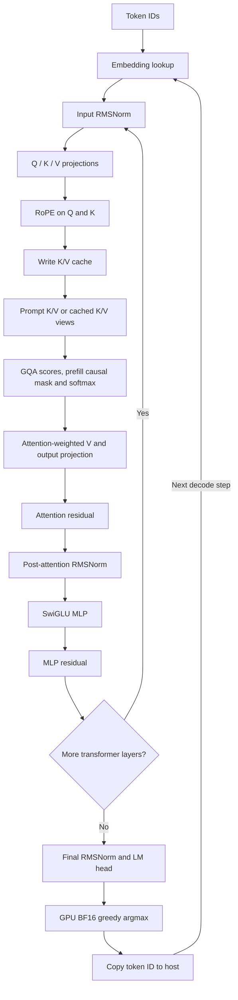
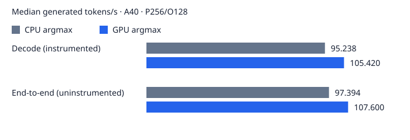

# tiny-vLLM — C++/CUDA LLM Inference Engine

tiny-vLLM implements BF16 autoregressive inference for **Llama 3.2 1B Instruct** in C++/CUDA, using custom kernels and cuBLAS. It includes contiguous and paged KV caches, a four-slot static request scheduler, and tools for numerical validation, profiling and benchmarking.

**GPU greedy selection improved decode throughput by 10.69% and end-to-end throughput by 10.48% on an NVIDIA A40**, preserving generated tokens in the tested workloads. This is an educational implementation, independent of the official vLLM project; it is not a production serving framework.

[Architecture](docs/architecture.md) · [Benchmark methodology](docs/benchmarks.md) · [Correctness](docs/correctness.md) · [Reproduction](benchmarks/README.md)

## Features

| Area | Implemented and validated scope |
|---|---|
| Model input | SafeTensors loading; Hugging Face tokenizer integration; tied embedding/LM-head weights |
| Transformer | BF16 weights, activations and KV storage; FP32 GEMM accumulation; RMSNorm, RoPE, grouped-query attention, residual connections and SwiGLU |
| Execution | cuBLAS projections; prompt prefill and autoregressive decode; contiguous KV cache |
| Paged cache | 16-token pages, logical-to-physical block tables, allocation/reuse and request isolation |
| Multi-request execution | Static request queue with at most four active slots; tested retirement and slot reuse |
| Selection and validation | GPU BF16 greedy argmax; intermediate-tensor diagnostics, regression tests, reproducible benchmarks and optional operation timers |

The validated paged decode path **gathers K/V into contiguous BF16 views and calls reference cuBLAS attention**. It does not implement fused attention operating directly on pages. Multi-request decode projections use one-row GEMMs to preserve the tested BF16 trajectory.

## Architecture



The model has 16 layers, hidden size 2,048, MLP size 8,192, 32 query heads, eight KV heads, head dimension 64 and vocabulary size 128,256. Cached K/V avoids re-projecting earlier tokens during decode. Paged requests own block tables into shared physical pools; the scheduler advances active requests through a shared layer loop. BF16 rounding and the selected GEMM implementation affect reproducibility. See [architecture details](docs/architecture.md).

## Performance

CPU versus GPU argmax on an NVIDIA A40: BF16 Llama 3.2 1B Instruct, CUDA 12.8, Release SM86, 256 prompt tokens and 128 generated tokens. Values are medians of ten repetitions per implementation after two warmups.

| Metric | CPU argmax | GPU argmax | Change |
|---|---:|---:|---:|
| Decode throughput — instrumented wall | 95.238 tok/s | 105.420 tok/s | **+10.69%** |
| End-to-end throughput — uninstrumented | 97.394 tok/s | 107.600 tok/s | **+10.48%** |
| TTFT — instrumented wall | 16.992 ms | 15.739 ms | −7.38% |
| End-to-end latency — uninstrumented | 1314.251 ms | 1189.587 ms | −9.49% |



[Source measurements and statistics](benchmarks/results/optimization_summary.json) · [Timing definitions and limitations](docs/benchmarks.md)

## Optimization: Moving Greedy Selection to the GPU

The original selector copied all 128,256 FP32 logits—**513,024 bytes per generated token**—to the CPU for BF16 rounding and greedy scanning. Host timers measured approximately **107.2 ms of CPU scanning across 127 decode selections** in one profiled generation. CUDA events and host timers supplied operation evidence; Nsight Compute hardware-counter profiling was blocked by **`ERR_NVGPUCTRPERM`**. No successful Nsight hardware profile is claimed.

The replacement uses two CUDA reduction stages: block-local maxima followed by a global maximum. It preserves BF16 round-to-nearest-even, lowest-token-ID ties and the original NaN/Inf behavior, including token-zero NaN handling. Only the **4-byte selected token ID** returns to the CPU. The **128,256× reduction in selection-transfer payload** is a byte-count ratio, not a bandwidth or inference speedup.

The independently timed outcome is **10.69% higher decode throughput and 10.48% higher end-to-end throughput**, with matching tested token sequences. [Profiling evidence](docs/profile.md) and [reconstructable CPU/GPU sources](benchmarks/README.md#historical-source-reconstruction) accompany the measurements.

## Static batching

Fixed simultaneous requests, each with 128 prompt and 128 output tokens; five repetitions after two warmups. Throughput and completion times below use full **uninstrumented** generation calls, including prefill, scheduling, decode and cleanup.

| Active requests | Aggregate output throughput | E2E completion time | Throughput / batch 1 |
|---|---:|---:|---:|
| 1 | 92.600 tok/s | 1382.288 ms | 1.000× |
| 2 | 95.418 tok/s | 2682.920 ms | 1.030× |
| 4 | 94.316 tok/s | 5428.552 ms | 1.019× |

Concurrency produces modest aggregate gains while increasing per-request latency. One-row projections chosen for numerical compatibility limit batched GEMM reuse. The scheduler has **four active slots**; these experiments establish static batching, not dynamic-arrival continuous batching or network serving. [Per-request TTFT/ITL and memory evidence](docs/benchmarks.md#static-batching-latency).

## Correctness

Saved validation establishes six passing gates; 13/13 paged regression prompts with matching generated tokens; 5,480 matching intermediate-tensor comparisons; 704 matching cache comparisons; and 116 argmax cases (five original plus 111 edge/random cases). CPU/GPU selectors produced identical tokens in the measured comparison workloads.

Historical Hugging Face validation recorded **376/379 (99.2%) shared-prefix BF16 token-selection agreement**. This measures selection on common engine prefixes, not free-running generation equivalence. Mathematically equivalent reductions can round differently in BF16; no universal equivalence across hardware or prompts is claimed. [Tests, numerical root causes and scope](docs/correctness.md).

## Build and run

Run commands from the repository root on Linux with an NVIDIA GPU and a compatible driver. The verified environment uses CUDA 12.8.93, GNU C++ 13.3, CMake, cuBLAS and `nlohmann/json.hpp`; SM86 is the tested A40 target. Python 3.12 and Transformers 5.19.0 provide tokenization.

```bash
# Ubuntu; install the CUDA toolkit and NVIDIA driver separately.
sudo apt-get update
sudo apt-get install -y build-essential cmake nlohmann-json3-dev python3-venv
python3 -m venv .venv
. .venv/bin/activate
python3 -m pip install -r requirements.txt
```

Obtain authorized access to [Llama 3.2 1B Instruct](https://huggingface.co/meta-llama/Llama-3.2-1B-Instruct), accept its applicable terms, and place `model.safetensors`, `config.json`, `tokenizer.json`, `tokenizer_config.json` and any accompanying tokenizer assets in `models/llama-3.2-1b-instruct/`. Checkpoint SHA-256: `1ff795ff6a07e6a68085d206fb84417da2f083f68391c2843cd2b8ac6df8538f`. Weights and credentials are excluded from this repository.

```bash
cmake -S . -B build -DCMAKE_BUILD_TYPE=Release \
  -DCMAKE_CUDA_ARCHITECTURES=86 -DBUILD_PAGED_TESTS=ON \
  -DBUILD_BENCHMARKS=ON -DBUILD_OPERATION_PROFILER=ON
cmake --build build -j4
ctest --test-dir build --output-on-failure --stop-on-failure -j1

python3 src/python/tokenizer.py "The capital of France is" \
  --model models/llama-3.2-1b-instruct --output prompt.json
./build/tiny_vLLM models/llama-3.2-1b-instruct/model.safetensors \
  prompt.json 32 1024 contiguous
# Substitute paged for contiguous to use the paged path.

mkdir -p benchmarks/local
./build/inference_benchmark models/llama-3.2-1b-instruct/model.safetensors \
  benchmarks/configs/quick.json benchmarks/local/quick.jsonl
python3 benchmarks/scripts/verify_results.py benchmarks/local/quick.jsonl
python3 benchmarks/scripts/summarize.py benchmarks/local/quick.jsonl \
  --output benchmarks/local/summary
```

[Full benchmark and historical-source reproduction](benchmarks/README.md). Release validation scope is recorded in [docs/release-validation.md](docs/release-validation.md).

## Project structure

```text
include/                    Engine, cache and instrumentation headers
src/model/                  CUDA kernels, transformer, caches and selector
src/engine/                 Contiguous/paged generation and static scheduler
src/main.cu                 SafeTensors loader and inference CLI
src/python/                 Tokenizer and reference validation utilities
tests/                      Six correctness gates and numerical diagnostics
benchmarks/configs/         Preserved benchmark configurations and quick check
benchmarks/scripts/         Verification, summaries and source reconstruction
benchmarks/results/         Original measurements, statistics and provenance
benchmarks/patches/          Historical implementation reconstruction patches
docs/                       Architecture, correctness and timing methodology
```

## Limitations and future work

The engine is single-GPU, specialized to the tested BF16 checkpoint, supports context up to 1,024 tokens and at most four active requests, and has no network serving layer or verified dynamic-arrival serving. Host code advances token generation. Paged attention gathers temporary K/V views, and attention launches/cuBLAS calls remain substantial overhead.

Potential future work includes fused GQA attention, fewer launches, improved batched GEMM utilization, reusable page metadata, GPU-resident token scheduling and validation across GPU architectures. These are planned directions, not implemented features.
